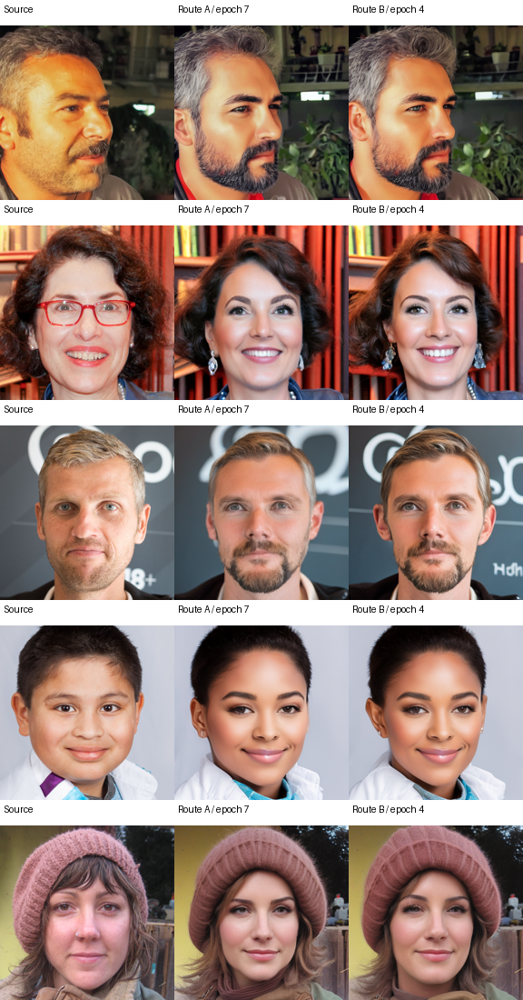
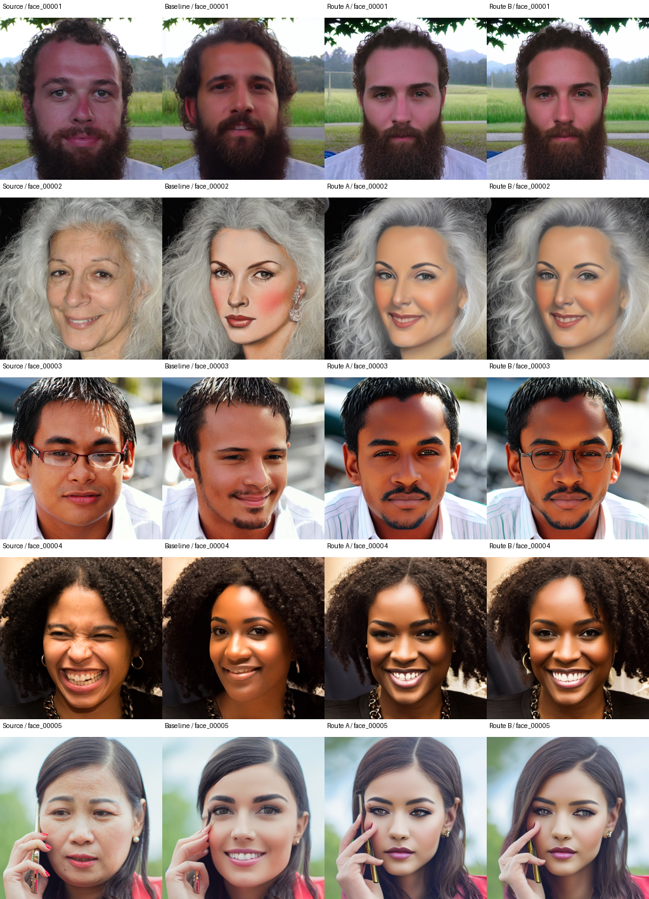
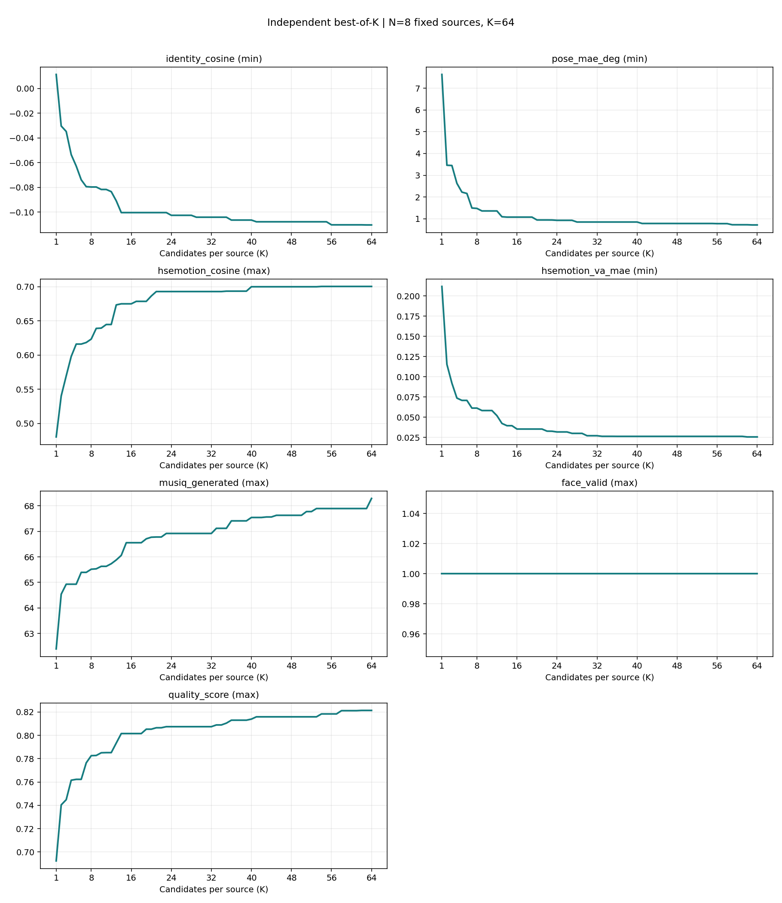
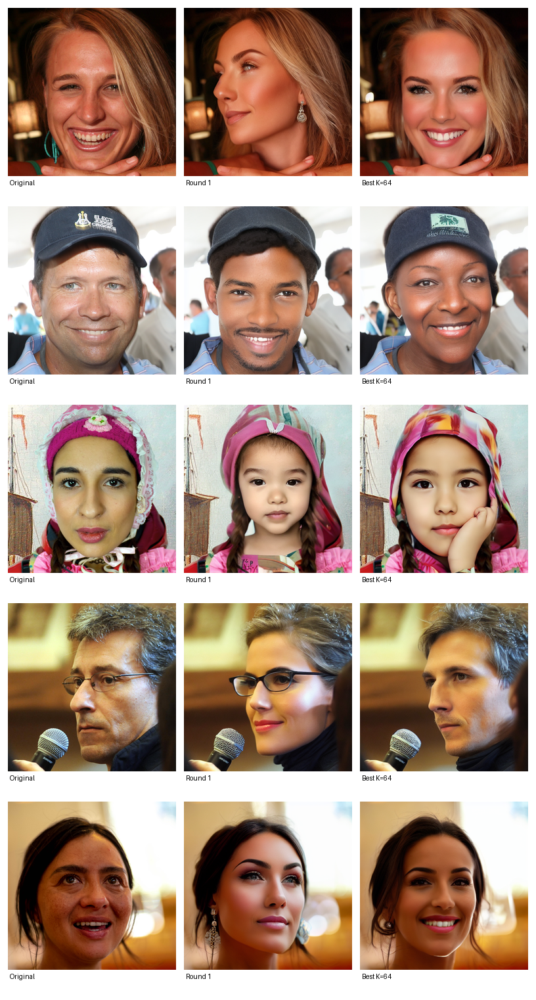
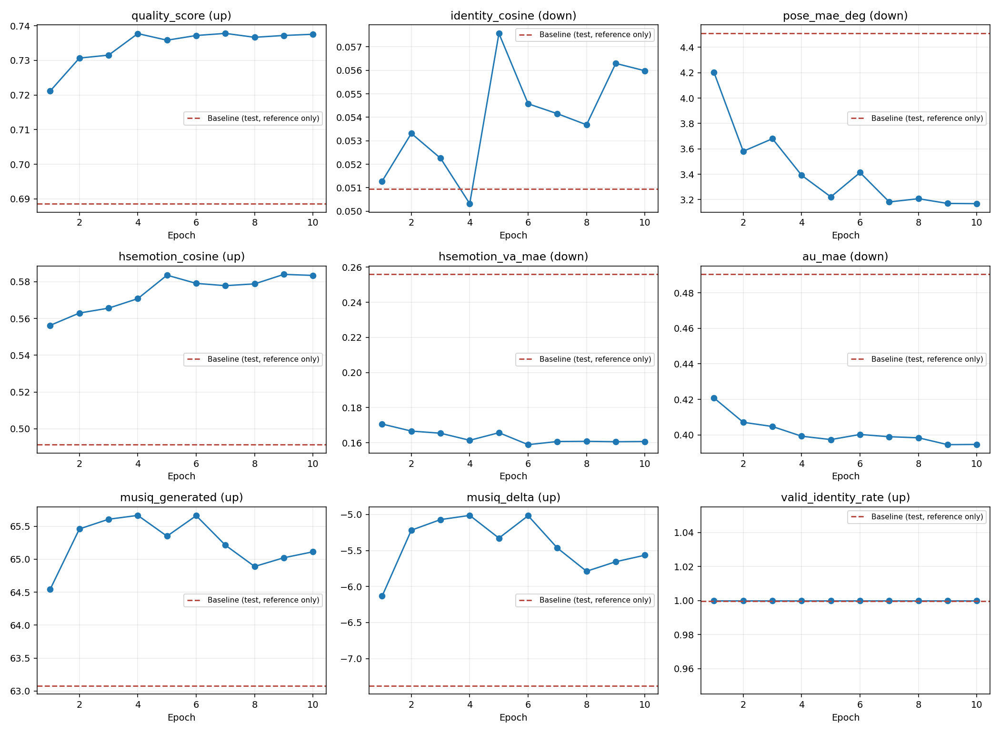
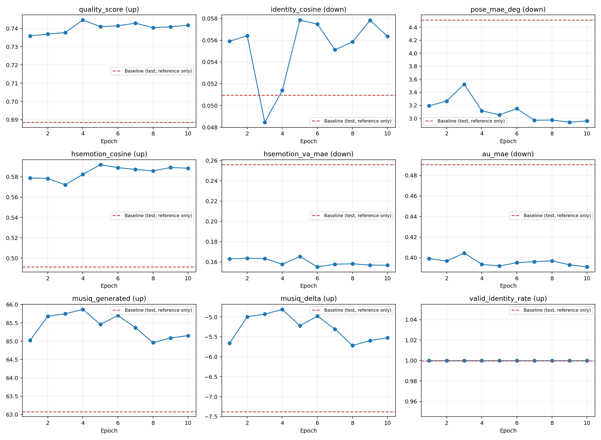

# 图像生成 · 第14组：基于视觉条件扩散模型的人脸匿名化

本项目在改变人脸身份的同时，尽量保留原图表情、姿态和自然视觉质量。我们采用 **64候选教师筛选 → 匿名伪监督配对 → CLIP + IP-Adapter Plus + UNet LoRA 微调**，并比较直接训练与两阶段训练路线。最终学生从随机噪声生成整张匿名图，输入为冻结视觉编码器的隐特征，不输入源图像素/latent，不需要用户文本。

## 目录

```text
ImageGeneration/group-14/
  README.md           # 项目介绍、使用入口、结果与局限
  .gitignore          # 仅本组的忽略规则
  code/
    README.md         # 完整安装、权重下载、数据结构和A/B复现命令
    requirements.txt
    THIRD_PARTY.md
    src/              # 特征缓存、模型、训练、推理和checkpoint评估
    teacher/          # 一次教师采样，可多任务并行64轮
    data_selection/   # 固定评分和逐源图64选一
    evaluation/       # ArcFace/姿态/HSE/VA/AU/MUSIQ
    scripts/          # 环境变量控制的运行入口与submission打包
  results/            # 实验曲线与样例图片
```

数据集和模型权重需按下方说明准备。示例图片来自课程FFHQ数据及模型生成结果。

## 环境和使用方法

Python 3.10，匹配CUDA的PyTorch/torchvision；训练使用单节点4张A100-80G、bf16、DDP，支持调整为其他GPU数量。注意力计算使用PyTorch SDPA。完整AU评估还需编译OpenFace。

```bash
cd ImageGeneration/group-14/code
# 先安装与当前CUDA匹配的torch和torchvision，再安装其余依赖
pip install -r requirements.txt
pip install --no-deps pyiqa==0.1.13
export PROJECT_ROOT=/absolute/path/to/workspace
export MODEL_ROOT=/absolute/path/to/models
```

pyiqa仅用于MUSIQ，其其他架构的旧Transformers依赖与本工程冲突，故MUSIQ所需依赖显式列出后单独安装pyiqa。请按上述顺序安装。

按[代码说明](code/README.md)放置课程数据、下载RV5.1、IP-Adapter Plus/CLIP和官方MSE VAE等权重。下载链接、完整文件结构、OpenFace配置、特征准备与全部脚本参数均在该文档。

复现顺序：

1. 使用正式train/val/test划分（16000/2000/2000），不重新随机拆分。可用 `scripts/sample_teacher.sh` 对训练图采样64轮，`scripts/select_teacher.sh` 逐图按综合分选一张匿名监督图，形成JSONL配对；已有配对时可直接从缓存开始。
2. `SPLIT=train bash scripts/prepare.sh` 缓存 `[257,1280]` CLIP hidden states；训练入口默认也会检查/准备缓存，缺失时才提取。
3. 选择以下A/B训练路线，结束后默认评估完整val上的各checkpoint。

```bash
# 路线A：公开预训练底座初始化，直接使用MSE VAE训练
GPUS=4 BATCH_SIZE=16 GLOBAL_BATCH=64 SEED=20261031 bash scripts/train_direct.sh

# 路线B：原VAE第一阶段，然后MSE VAE第二阶段
GPUS=4 BATCH_SIZE=16 GLOBAL_BATCH=64 SEED=1324400183 bash scripts/train_stage1.sh
INIT_CHECKPOINT=/absolute/path/to/stage1_run/epoch_009 \
GPUS=4 BATCH_SIZE=16 GLOBAL_BATCH=64 SEED=20261031 bash scripts/train_stage2.sh
```

验证集选出的最佳模型为A的epoch 7和B第二阶段的epoch 4。B第二阶段加载第一阶段模型权重，并重新初始化优化器、学习率计划和训练步数。

```bash
# 使用验证集选出的checkpoint生成测试图片，并打包提交
SPLIT=test bash scripts/prepare.sh
CHECKPOINT=/absolute/path/to/best_checkpoint \
CONDITIONS="$PROJECT_ROOT/data/features_v4/test/conditions.jsonl" \
OUTPUT="$PROJECT_ROOT/outputs/test_generation" SEED=20261026 bash scripts/infer.sh
GENERATED="$PROJECT_ROOT/outputs/test_generation" \
SUBMISSION="$PROJECT_ROOT/outputs/submission.csv" bash scripts/submission.sh
```

## 方法与训练细节

冻结CLIP ViT-H/14提取原图倒数第二层token `[B,257,1280]`，预训练IP-Adapter Plus Resampler映射到`[B,16,768]`。图像token经独立K/V注意力注入Realistic Vision V5.1四通道UNet。训练Resampler、IP图像K/V及UNet attention LoRA；冻结CLIP、VAE和UNet原权重，文本分支使用固定空条件。

监督是64选一匿名目标y，而非原图x。VAE编码目标并按DDPM时间步加噪，训练标准去噪MSE：

$$z_t=\sqrt{\bar\alpha_t}E(y)+\sqrt{1-\bar\alpha_t}\epsilon,\qquad L=\mathbb E\|\epsilon_\theta(z_t,t,C(x))-\epsilon\|^2/(CHW).$$

没有额外像素/身份/表情/LPIPS训练损失；这些属性主要通过伪监督筛选保持。10%原始CLIP条件置零，经同一Resampler学习空条件；推理CFG为`epsilon_null + 3*(epsilon_cond-epsilon_null)`。IP_SCALE=.8是图像注意力强度，不是CFG。

每阶段10epochs、2500更新，global batch64；AdamW学习率1e-4、weight decay.01、cosine schedule、warmup.05，LoRA rank/alpha32、dropout.05，512px。最终推理官方MSE VAE、DPM++ 2M Karras、30步、CFG3、IP.8。A的最佳模型训练了1750次更新；B的最佳模型经历了第一阶段2250次、第二阶段1000次更新。

## 结果展示与评估口径

身份、姿态和表情指标以图中的最大人脸为评估对象：ArcFace身份cos越低越不像原身份；姿态角MAE越低越好；HSE隐特征cos越高越好；VA/AU误差越低越好；MUSIQ用于衡量整图感知质量。评测256px，生成图JPEG75；AU由OpenFace静态回归，仅在有效配对上统计。单项均值分母可能不同。综合分Q按每张图计算后取均值，无法完成必要特征配对的图片记0分，总分母为2000。

Q权重为身份.25、姿态.20、HSE.20、VA.10、MUSIQ.20、有效性.05；各项归一化依次为clip((.35-id)/.35)、exp(-pose/15)、clip((hse-.2)/.8)、exp(-VA/.5)、clip((musiq-20)/60)，clip到[0,1]。AU不参与Q。

| 模型 | 划分/规模 | Q↑ | 身份cos↓ | 姿态°↓ | HSEcos↑ | VA↓ | AU↓ | MUSIQ↑ | 身份有效 | AU有效 |
|---|---|---:|---:|---:|---:|---:|---:|---:|---|---|
| Baseline一次采样 | test/2000，跨划分参考 | .68860 | .05096 | 4.50925 | .49138 | .25588 | .49033 | 63.08109 | 1999/2000 | 1757/2000 |
| A最佳epoch7 | val/2000 | .73782 | .05415 | 3.18187 | .57784 | .16069 | .39901 | 65.21270 | 2000/2000 | 1815/2000 |
| B最佳新epoch4 | 同一val/2000 | .74460 | .05138 | 3.11604 | .58235 | .15771 | .39354 | 65.86755 | 2000/2000 | 1801/2000 |

表中Baseline来自test，A/B来自val。两条路线采用相同的验证推理配置，B的综合分比A高0.00678。两条最佳模型已完成2000张test图片生成，提交CSV另行交付。

### 同源验证前五张：原图、A最佳、B最佳



### 同源test前五张：原图、Baseline、A、B



以上两组对比分别取val和test清单中的前五张。

### 采样累计最优与教师监督

固定8张训练源图×64候选=512记录，逐源图、逐指标独立取历史best后求均值；Q在真实候选Q中独立取best。K表示实际候选数，身份/姿态/VA取min，HSE/MUSIQ/Q取max。Q(K=1/8/32/64)=.692319/.782595/.807468/.821399，后段收益趋缓。




### A/B各epoch验证曲线




## 局限与展望

生成图片仍有皮肤过于光滑、妆感较强和人物外观年轻化的问题，局部表情与眼镜等配饰也会发生变化。一个可能的原因是教师生成的监督图本身偏向美颜风格，筛选指标又没有专门衡量皮肤纹理，学生模型便学到了这种倾向。

后续可固定多样人像小样本对比FLUX Fill/SDXL等teacher，加入自然皮肤纹理和人工盲评，再决定是否重构监督。还需要相同test上的baseline/A/B定量对比、多seed等预算实验、独立身份识别器及失败样本分组统计。

模型和方法来源见[第三方说明](code/THIRD_PARTY.md)及[权重下载说明](code/README.md)。完整数据和模型权重按各自上游许可单独获取。
